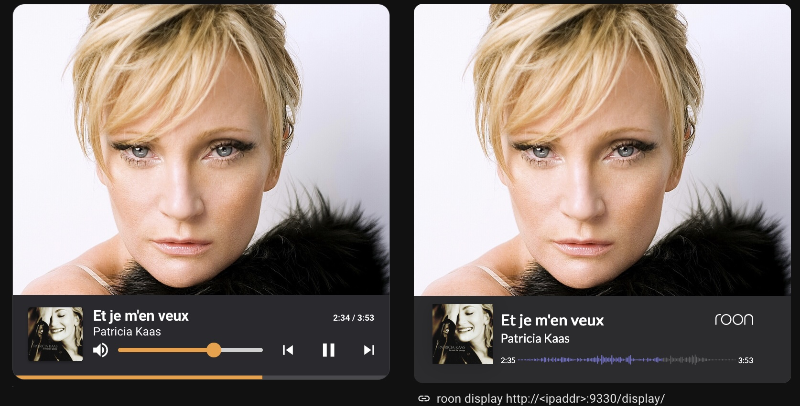
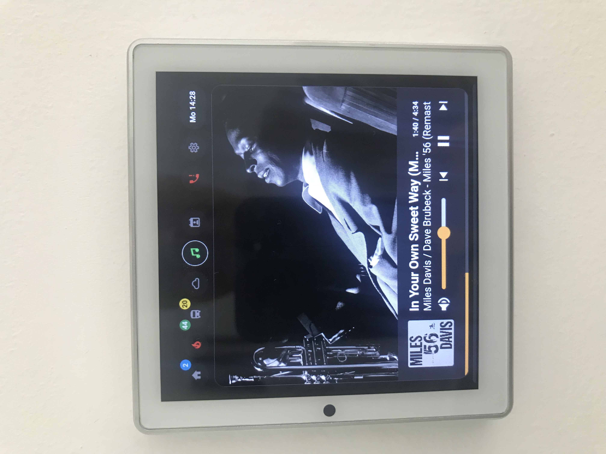
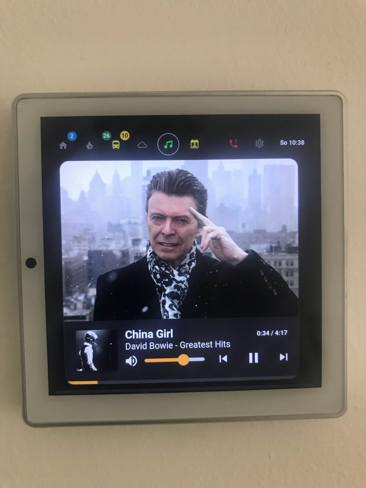

# roon-card

A Home Assistant dashboard card and a small bridge that bring a Roon-style "now playing" view to lightweight displays.

- **roon-card** is a custom Lovelace card. It shows the album cover, rotating artist images, title, artist and album, and offers transport controls, volume, seeking and synchronized lyrics.
- **roon-bridge** is a small Node.js service. It reads the playback state of your Roon zones from the Roon Core and publishes it to your MQTT broker.

The original Roon Display needs a modern browser and does not run on lightweight displays such as the Shelly Wall Display. **This card does**



The right side is the original Roon Display, the left side is roon-card. Tapping the cover or the artist image shows the cover enlarged.

<p>
  
  
</p>

**Fallback mode:** If the roon bridge does not deliver artwork information (for example because it is stopped), the card keeps working with the data of the regular `media_player` entity. It then shows the cover provided by the player, and the status pill shows `Fallback`.

## Requirements

- Home Assistant with the MQTT integration
- Roon Core
- A `media_player` entity that controls your streamer (all transport buttons call services on it)
- For the bridge: a Debian/Ubuntu host (or similar) with Node.js 18 or newer (version assumed, not verified)

The card has no dependencies on other cards (no button-card, no card_mod).

---

# Installation of roon-card

## Via HACS

1. Open HACS in Home Assistant.
2. Menu (three dots) → **Custom repositories**.
3. Add `https://github.com/rudiratlos/roon-card.git` with the category **Dashboard**.
4. Search for "roon-card", install it and reload your browser.

HACS adds the resource itself. If you added the resource manually before, remove it to avoid loading the card twice.

## Manual installation

```bash
cd /config/www/
wget https://raw.githubusercontent.com/rudiratlos/roon-card/refs/heads/main/roon-card.js
mkdir -p icons
wget -O icons/roon-logo.png https://raw.githubusercontent.com/rudiratlos/roon-card/refs/heads/main/img/roon-logo.png
```

### Add the resource

YAML mode (`configuration.yaml`):

```yaml
lovelace:
  resources:
    - url: /local/roon-card.js?v=2.0.0
      type: module
```

UI mode:

1. Enable **Advanced mode** in your user profile.
2. Go to **Settings → Dashboards → ⋮ → Resources**.
3. Click **Add resource** and enter:
   - **URL:** `/local/roon-card.js?v=2.0.0`
   - **Type:** `JavaScript Module`
4. Save and reload the browser.

When you update the file, increase the number after `?v=` so that browsers do not use the cached version.

---

# Usage

Minimal configuration:

```yaml
type: custom:roon-player-card
player: media_player.streamer
sensor: sensor.roon_auralic_json
status_sensor: sensor.roon_bridge_status
roon_url: http://<roon-server-ip>:9330/api/image/
```

Full example with all common options:

```yaml
type: custom:roon-player-card
player: media_player.streamer
sensor: sensor.roon_auralic_json
status_sensor: sensor.roon_bridge_status
roon_url: http://<roon-server-ip>:9330/api/image/
bg_aspects_main:
  - 12by10
  - 4by3
  - 16by12
  - 16by7
bg_aspects_other:
  - 12by10
  - 4by3
  - 16by12
  - 16by7
bg_interval: 15
zoom_seconds: 30
cover_fit: contain
lyrics_offset: 0.2
max_height: 85vh
format_attr: []
options: [ nosongtext ]
```

Replace `player`, `sensor` and `roon_url` with the values of your installation.

## Showing an image when nothing is playing

The card itself has no idle screen. A common approach is a `conditional` card that shows a picture when the player is neither playing nor paused:

```yaml
type: vertical-stack
cards:
  - type: conditional
    conditions:
      - condition: state
        entity: media_player.streamer
        state:
          - playing
          - paused
    card:
      type: custom:roon-player-card
      player: media_player.streamer
      sensor: sensor.roon_auralic_json
      status_sensor: sensor.roon_bridge_status
      roon_url: http://<roon-server-ip>:9330/api/image/
      options: [ nosongtext ]
  - type: conditional
    conditions:
      - condition: state
        entity: media_player.streamer
        state_not: playing
      - condition: state
        entity: media_player.streamer
        state_not: paused
    card:
      type: picture
      image: /local/icons/roon-logo.png
      tap_action:
        action: none
```

## Configuration options

| Name | Type | Default | Description |
| --- | --- | --- | --- |
| `type` | string | | must be `custom:roon-player-card` |
| `player` | string | | **required.** media_player entity of your streamer |
| `sensor` | string | | MQTT sensor that receives the bridge data (see below). Without it, the card runs in player-only mode |
| `roon_url` | string | | base URL of the Roon image API, ending in `/api/image/`. Without it, no artist images are shown and the cover comes from the player |
| `bg_aspects_main` | list | `['12by10','4by3']` | image formats shown for the first artist |
| `bg_aspects_other` | list | `['12by10']` | image formats shown for further artists |
| `bg_interval` | number | `15` | seconds per image |
| `zoom_seconds` | number | `30` | the enlarged cover hides itself after this time, or on a new track |
| `cover_fit` | string | `contain` | `contain` shows the whole cover, `cover` fills the area |
| `lyrics_dim` | number | `0.55` | how much the image is dimmed behind the lyrics (0 to 1) |
| `lyrics_offset` | number | `0.2` | seconds, positive shows the lyrics earlier, negative later |
| `format_attr` | list | `[]` | attribute names to show as audio format, e.g. `[sample_rate, bit_depth]` |
| `clock_url` | string | `/` | URL used to compare the display clock with Home Assistant (only the `Date` header is read) |
| `max_height` | string | `85vh` | maximum card height, any CSS length. The card is never higher than it is wide |
| `bar_h` | number | `112` | height of the bottom bar in px |
| `pad` | number | `20` | horizontal padding of the bottom bar in px |
| `options` | list | `[]` | switches, see below |

The image formats are passed to the Roon image API as `?aspect=...`. The formats `12by10`, `4by3`, `16by12` and `16by7` have been tested.

### Switches (`options`)

| Name | Description |
| --- | --- |
| `nosongtext` | do not show lyrics |
| `nostatus` | do not show the status pill (artist number, aspect, fallback, format) |
| `noaspect` | do not show the aspect ratio in the status pill |
| `noformat` | do not show the audio format in the status pill |
| `nounderline` | do not underline the name of the artist whose image is shown (only for tracks with several artists) |
| `noscroll` | do not scroll long titles, artists or albums, use "..." instead |
| `nostale` | disable the check whether the bridge data matches the current track |

### Audio format (bit depth, sample rate)

The Roon extension API does not provide sample rate or bit depth, so the bridge cannot deliver them. If your player or sensor has such attributes, list their names in `format_attr`. Check **Developer Tools → States** for your player. The values are shown as they are, for example `44100 24`.

### Lyrics and privacy

Lyrics come from [LRCLIB](https://lrclib.net). The card sends the first artist, title, album and duration of the current track to lrclib.net from the browser of the display. Not every track has synchronized lyrics. Use `nosongtext` to switch this off.

### HTTPS note

The Roon image API only delivers plain HTTP. If you open Home Assistant via HTTPS, browsers block these images (mixed content). Then run the images through an HTTPS reverse proxy and use its URL as `roon_url`.

---

# roon-bridge

## What it does

The bridge connects locally to the Roon Core, watches your audio zones and publishes one JSON message per zone to MQTT, whenever something changes. The message contains the playback state, volume and the raw metadata of the current track, including the keys of the cover and artist images. The URLs of the images are built by the card from `roon_url`, so no network address is stored in the bridge data.

## Installation (Debian/Ubuntu)

Log in to your Roon server via SSH and make sure Node.js is installed:

```bash
sudo apt update
sudo apt install -y nodejs npm
node --version   # 18 or newer is recommended
```

Install the bridge:

```bash
sudo git clone https://github.com/rudiratlos/roon-card.git /opt/roon-card
cd /opt/roon-card/bridge
sudo npm install
sudo cp roon-mqtt.service /etc/systemd/system/
sudo cp roon-mqtt.env.example /etc/roon-mqtt.env
sudo chmod 600 /etc/roon-mqtt.env
sudo nano /etc/roon-mqtt.env
```

edit /etc/roon-mqtt.env an set your data that fits your environment. See documentation below.

Enable and start the service:

```bash
sudo systemctl daemon-reload
sudo systemctl enable --now roon-mqtt.service
```

Follow the log:

```bash
sudo journalctl -u roon-mqtt.service -f
```

Finally open the **Roon Remote App** → **Settings → Extensions** and click **Enable** next to "Cover Fetcher LOCAL". Without this step the bridge is not allowed to read your zones.

### Update

```bash
cd /opt/roon-card && sudo git pull && (cd bridge && sudo npm install) && sudo systemctl restart roon-mqtt
```

## Configuration

The bridge reads its settings from environment variables. It looks for a `.env` file in this order: the path in `ENV_FILE`, `.env` next to `app.js`, `/etc/roon-mqtt.env`. Variables already set in the environment (for example by systemd) take precedence.

| Variable | Default | Description |
| --- | --- | --- |
| `MQTT_BROKER` | `mqtt://localhost` | protocol and host of the MQTT broker |
| `MQTT_USER` | empty | user name, leave empty if not needed |
| `MQTT_PASSWORD` | empty | password, leave empty if not needed |
| `MQTT_TOPIC` | `roon/now_playing` | base topic |
| `ROON_HOST` | `127.0.0.1` | host of the Roon Core |
| `ROON_PORT` | `9330` | WebSocket port of the Roon Core |
| `PAIR_TIMEOUT_MS` | `90000` | the bridge restarts if it is not paired with Roon within this time |
| `LOG_LEVEL` | `info` | `info` logs status and track changes, `debug` also logs the complete Roon protocol |

Example `/etc/roon-mqtt.env`:

```ini
MQTT_BROKER=mqtt://homeassistant.local
MQTT_USER=
MQTT_PASSWORD=
MQTT_TOPIC=roon/now_playing
ROON_HOST=127.0.0.1
ROON_PORT=9330
LOG_LEVEL=info
```


## Topics

| Topic | Content |
| --- | --- |
| `roon/now_playing/<zone>` | complete JSON of the zone (retained). `<zone>` is the zone name in lowercase without special characters, for example `auralic` |
| `roon/now_playing/status` | `online` or `offline` (retained) |

### status

| Topic | Content |
| --- | --- |
| starting | roon brige working, but not coupled with roon server |
| online | coupled with roon server, data will be delivered via mqtt |
| roon_disconnected | lost connection to roon server, roon bridge will be restarted by systemd |
| error | unexpected error or no coupling within PAIR_TIMEOUT_MS |
| offline | roon bridge not running |

status sensor holding the bridge status topic; any value other than online switches the card to fallback immediately


## Checking the data in Home Assistant

1. Go to **Settings → Devices & Services → MQTT → Configure**.
2. Under **Listen to a topic** enter `roon/now_playing/#` and click **Start listening**.
3. Play or skip a track. A message like this appears (shortened):

```json
{
  "zone_id": "160...017a7",
  "zone_name": "auralic",
  "state": "playing",
  "is_seek_allowed": true,
  "outputs": [
    { "output_id": "170...017a7", "name": "auralic",
      "volume": { "type": "number", "min": 0, "max": 100, "value": 68, "step": 1, "is_muted": false } }
  ],
  "timestamp": "2026-10-17T15:12:56.353Z",
  "now_playing": {
    "track": "I Remember Clifford [Live at Newport 1957]",
    "artist": "Dizzy Gillespie / Jon Hendricks / Benny Golson",
    "album": "Ultimate Dizzy Gillespie",
    "seek_position": 0,
    "length": 291,
    "image_key": "063fd5...032a",
    "artist_key": "66c5e7...51b1",
    "artist_keys": ["66c5e7...51b1", "..."]
  }
}
```

Use the `zone_name` of your streamer for the sensor below.

## The MQTT sensor

This sensor hands all required data to the card. Add it to your Home Assistant configuration (`configuration.yaml` or `mqtt.yaml`) and adjust the topic to your zone:

```yaml      
mqtt:
  sensor:
    - name: "Roon Bridge Status"
      state_topic: "roon/now_playing/status"

  sensor:
    - name: "Roon Auralic JSON"
      state_topic: "roon/now_playing/auralic"
      value_template: "{{ value_json.timestamp }}"
      json_attributes_topic: "roon/now_playing/auralic"
```

After reloading the MQTT configuration, open **Developer Tools → States** and search for `sensor.roon_auralic_json`. The state is the timestamp of the last message, and the complete payload is available as attributes.

---

# Troubleshooting

| Problem | Likely cause |
| --- | --- |
| "Custom element doesn't exist: roon-player-card" | the resource is missing, has the wrong type (must be `module`) or the browser uses a cached version. Increase `?v=` and reload |
| Card shows `Fallback` | the sensor does not match the current track. Check that the bridge is running and the sensor topic is correct. Use `nostale` if the titles of player and Roon are spelled differently |
| No artist images | `roon_url` is missing or wrong, the browser cannot reach the Roon server, or Home Assistant runs on HTTPS (see HTTPS note) |
| No lyrics | the track has no synchronized lyrics at LRCLIB, the service is temporarily down (the card retries after a minute), or `nosongtext` is set |
| Lyrics are out of sync | adjust `lyrics_offset`. A wrong clock on the display can also cause a shift of one or two seconds |
| Bridge does not start | `sudo journalctl -u roon-mqtt.service -n 50`. Check the extension is enabled in Roon and the broker settings in `/etc/roon-mqtt.env` |

# License

pls. see license file